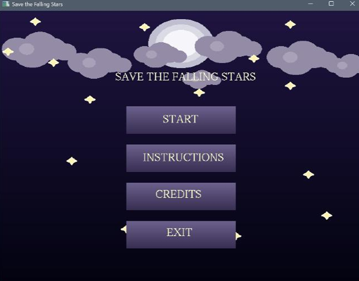
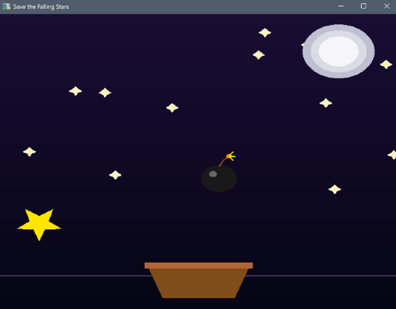
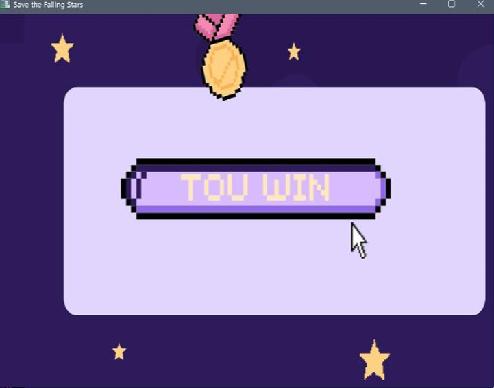
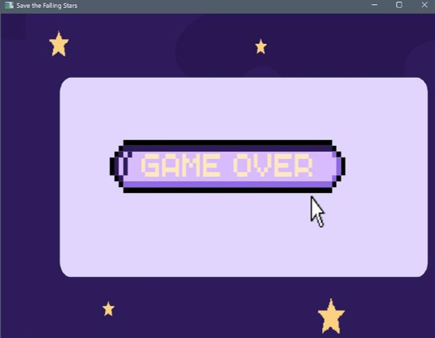

# Save The Falling Stars

A 2D arcade game built with C++ and OpenGL (GLUT). The player controls a basket to catch falling stars while avoiding bombs. Collecting 5 stars wins the game, and touching a bomb ends it.

Developed as a team project for the Computer Graphics course (CS2206) at Umm Al-Qura University.

## Screenshots

| Main Menu | Gameplay |
|-----------|----------|
|  |  |

| Win Screen | Game Over Screen |
|------------|------------------|
|  |  |

## Features
- Six screens: Main Menu, Instructions, Credits, Gameplay, Win, and Game Over
- Falling star and bomb with random positions
- Basket movement using the keyboard arrow keys
- Collision detection and win/lose conditions
- Reusable night-sky background (gradient, moon, clouds, and stars)
- Texture mapping (BMP images) for the Win and Game Over screens
- Mouse-based menu navigation using a state variable

## How to Play
- Use the **Left / Right arrow keys** to move the basket.
- Catch the falling stars.
- Avoid the bombs.
- Collect **5 stars** to win.

## How to Run
1. Open the project in Visual Studio.
2. Add `SaveTheFallingStars.cpp` to Source Files.
3. Make sure OpenGL / FreeGLUT / GLEW are linked.
4. Place `win.bmp` and `lose.bmp` in the same folder as the program.
5. Build and run (Ctrl + F5).

## Files
- `SaveTheFallingStars.cpp`: full source code of the game
- `win.bmp` / `lose.bmp`: textures used by the Win and Game Over screens
- `menu.png`, `gameplay.png`, `win.png`, `lose.png`: screenshots

## Technologies
C++, OpenGL, GLUT / FreeGLUT, GLEW, Computer Graphics

## Team
- Lamyaa Dia Mohammed (Team Leader): main menu, instructions and credits screens
- Ruwaina Alharbi: game objects (star, bomb, basket), game logic, and basket movement
- Taif Alqethami: gameplay background scene
- Sara Alharthi: win and game over screens, and texture mapping
